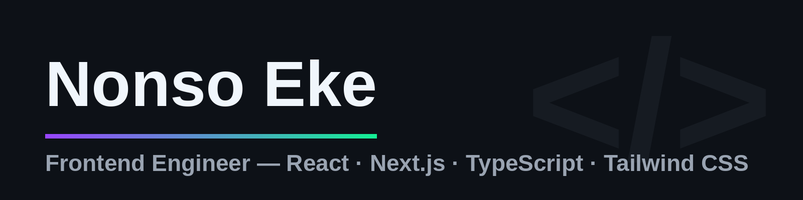

I build fast, polished interfaces for web3 products — and I ship them to production, not to localhost. Solo builder behind **[Panta Rooms](https://panta-rooms.vercel.app)**, a live prediction-market social app on Solana: design system, wallet flows, real-time trading UI, end-to-end tested.

## Featured: Panta Rooms — [live](https://panta-rooms.vercel.app) · [code](https://github.com/Kingjami47/panta-rooms)

*The social layer for prediction markets on Solana.* Every question becomes a market; every market becomes a Room with live trades and community discussion. Built solo on the Panta API.

- **Real-time trading UI** — live trade tape, YES/NO position panel, wallet-connected flows (Phantom · Solflare)
- **Design system** — shadcn/ui on Radix primitives, dark-first, responsive from phone to desktop
- **Complex flows made simple** — AI-assisted market creation: question → fee quote → wallet signature → live market, in one wizard
- **Production discipline** — strictly typed API layer, 24/24 e2e suite passing, security-hardened server proxy, honest live-vs-demo states

**Stack:** TypeScript · Next.js 16 · React 19 · Tailwind CSS 4 · shadcn/ui · Radix · Prisma · Bun · Solana web3.js · Framer Motion

## How I work

- **Interfaces that feel fast** — motion with purpose, honest empty states, no layout jank
- **Accessible by default** — keyboard flows, labelled controls, contrast that passes
- **Ship it, then harden it** — end-to-end tests, deploy-first, security review before launch

## Open to frontend roles

Need someone who turns complex products into clean, fast interfaces? → [**DM me on X**](https://x.com/__cryptowizard)
